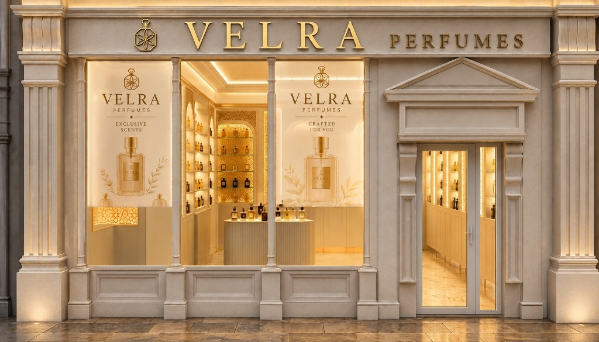

# Vel Ra — Interactive Showroom



A luxury perfume boutique concept presented as an interactive 3D showroom, visual dossier and render gallery. Visitors explore the space and technical schedules in one place instead of switching between separate images and drawings.

[Live showroom](https://velra-viewer.ranakaharian1.workers.dev/) · [Make it yours](docs/SETUP.md)

## Explore the sections

[3D viewer](#3d-viewer) | [Design dossier](#design-dossier) | [Gallery](#gallery) | [Review & PDF](#review--pdf) | [Own hosting](docs/SETUP.md)

### 3D viewer

Three.js model with walkthrough, top-down view, wireframe and lighting/quality controls. Mouse: drag to orbit, wheel to zoom. Touch: drag to orbit, pinch to zoom.

### Design dossier

Overview, zoning, materials and tabbed dimension, FF&E, lighting and MEP schedules. These describe the concept; site measurements, engineering and applicable requirements need independent verification before construction.

### Gallery

Existing showroom renders, material samples and architectural details with a lightbox. Open an image to zoom, rotate or pan; press Escape to close.

### Review & PDF

Complete the checklist and enter a name to save a local review. This is browser localStorage, not a verified electronic signature, cloud record or legal approval. Clearing storage removes it. Print uses the browser's **Save as PDF** option. No account service, Chrome extension or cloud sync is included.

## Run locally

Install Node.js 22+:

```sh
npm ci
npm run dev
```

Open the localhost URL printed by Vite. For production:

```sh
npm test
npm run build
npm run preview
```

The generated site is in `dist/`. [GitHub transfer, Cloudflare and model replacement instructions](docs/SETUP.md).

## Rights

Source code is MIT; see [LICENSE](LICENSE). Third-party libraries retain their licences. Supplied brand artwork, reference photographs, textures and models are demonstration/reference material; verify rights before reusing them commercially. Replace them with your own assets when making a different project. No claim of independent architectural certification is made by this viewer.
